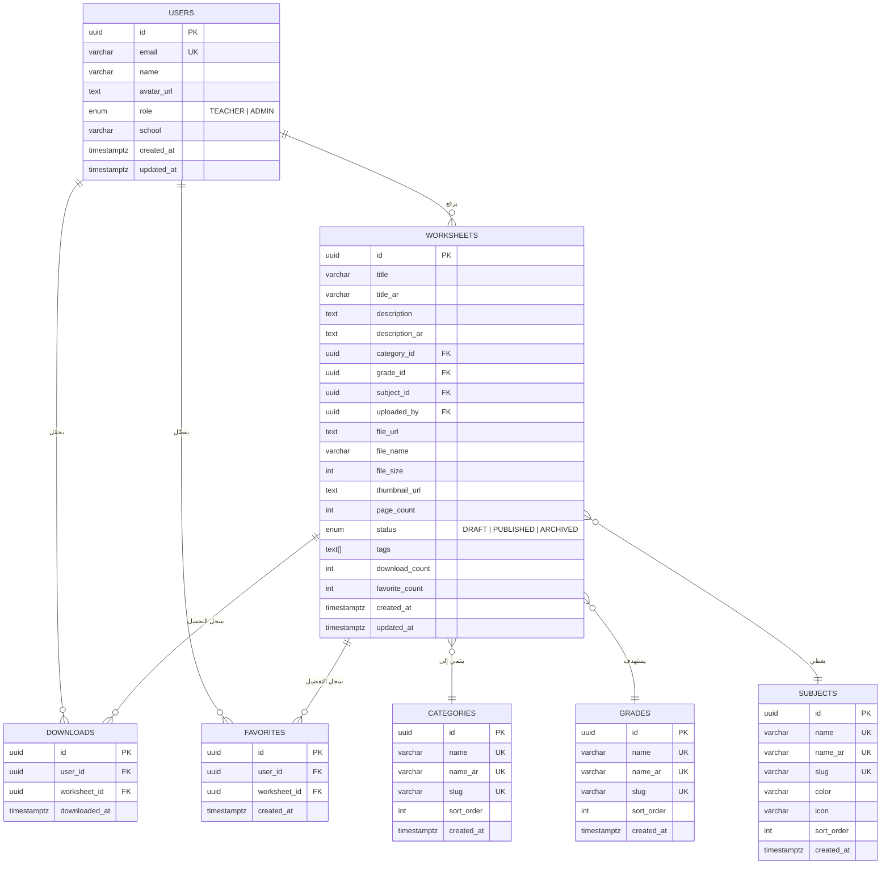

# 📚 بنك أنشطة المعلم (Teacher's Activity Bank)
## الدليل المعماري الشامل والكامل — المرحلة الأولى (Backend Master Specification)

> **ملاحظة للمطور ونموذج الذكاء الاصطناعي التالي (Frontend AI):**  
> هذا الملف هو **المصدر الوحيد والمطلق للحقيقة (Single Source of Truth)** لكامل البنية التحتية، وقواعد البيانات، ومسارات الـ API، ونماذج البيانات للمرحلة الأولى من تطبيق "بنك أنشطة المعلم". تم تصميم كل شيء ليكون متوافقاً مع اللغة العربية (RTL) والإنجليزية، وقابلاً للتوسع، وآمناً، وسهل الربط مع أي واجهة أمامية.

---

## الفهرس العام
1. [توصية وتبرير حزمة التقنيات (Tech Stack)](#1-توصية-وتبرير-حزمة-التقنيات-tech-stack)
2. [مخطط قاعدة البيانات العلائقية بالتفصيل (Database Schema)](#2-مخطط-قاعدة-البيانات-العلائقية-بالتفصيل-database-schema)
3. [كود نموذج بريزما الموحد (Prisma Schema)](#3-كود-نموذج-بريزما-الموحد-prismaschema)
4. [أوامر SQL لإعداد Supabase وسياسات الحماية (RLS & Triggers)](#4-أوامر-sql-لإعداد-supabase-وسياسات-الحماية-rls--triggers)
5. [سكربت البيانات الأولية (Database Seeding)](#5-سكربت-البيانات-الأولية-database-seeding)
6. [معمارية واجهات البرمجة والعقود (Core API Architecture & Contracts)](#6-معمارية-واجهات-البرمجة-والعقود-core-api-architecture--contracts)
7. [هيكل مجلدات المشروع (Project Folder Structure)](#7-هيكل-مجلدات-المشروع-project-folder-structure)
8. [أكواد طبقة الخدمات والتحقق ومسارات الـ API (Core Implementation Code)](#8-أكواد-طبقة-الخدمات-والتحقق-ومسارات-الـ-api)
9. [دليل التشغيل والربط للواجهة الأمامية (Setup & Frontend Handoff Guide)](#9-دليل-التشغيل-والربط-للواجهة-الأمامية-setup--frontend-handoff-guide)

---

## 1. توصية وتبرير حزمة التقنيات (Tech Stack)

تم اختيار هذه الحزمة لتحقيق أعلى سرعة إطلاق للنسخة التجريبية (MVP) دون أي ديون تقنية (Technical Debt)، مع ضمان الأمان والنوعية الصارمة (Type Safety):

| الطبقة | التقنية المختارة | سبب الاختيار لهذا المشروع تحديداً |
|---|---|---|
| **بيئة العمل الموحدة** | **Next.js 15 (App Router)** | إطار عمل موحد بلغة TypeScript يدعم Server Components و Route Handlers. يلغي الحاجة لبناء سيرفر Node.js منفصل، ويسرّع بناء واجهات الـ API للنسخة التجريبية. |
| **لغة البرمجة** | **TypeScript 5 (Strict Mode)** | لغة صارمة النوع من قاعدة البيانات حتى الواجهة الأمامية، تمنع الأخطاء أثناء التطوير وتسهّل تسليم المشروع لنموذج الذكاء الاصطناعي القادم. |
| **قاعدة البيانات** | **PostgreSQL (عبر Supabase)** | قاعدة بيانات علائقية قوية ضرورية للفلترة متعددة الأبعاد (الصف الدراسي × المادة × التصنيف × الوسوم)، مع دعم كامل للبحث النصي باللغة العربية. |
| **محرك الربط (ORM)** | **Prisma ORM 6** | يولد أنواع البيانات تلقائياً، ويوفر كتابة استعلامات آمنة (Type-safe) وخالية من حقن SQL (SQL Injection). |
| **المصادقة والمستخدمين** | **Supabase Auth (`@supabase/ssr`)** | إدارة جاهزة للجلسات والرموز الأمنية (JWT/Cookies) مع دعم التسجيل بالبريد أو Google OAuth بدون كتابة سيرفر مصادقة مخصص. |
| **تخزين الملفات (PDF)** | **Supabase Storage (S3-compatible)** | حاوية ملفات خاصة محمية بسياسات أمان مشددة (RLS) وروابط تحميل مؤقتة وموقّعة (Signed URLs) تمنع التنزيل العشوائي. |
| **التحقق من البيانات** | **Zod 3** | للتحقق الصارم من المدخلات ومطابقتها للشروط على الخادم ومشاركتها مع الواجهة الأمامية. |

---

## 2. مخطط قاعدة البيانات العلائقية بالتفصيل (Database Schema)

### الرسم البياني للعلاقات (ER Diagram)



---

### مواصفات الجداول والحقول (Table Dictionary)

#### 1. جدول المعلمين والمستخدمين `users`
*مرتبط مباشرة بمعرّف المصادقة في Supabase (`auth.users.id`).*
- `id` (UUID, Primary Key, `gen_random_uuid()`): المعرف الفريد.
- `email` (VARCHAR 255, UNIQUE, NOT NULL): البريد الإلكتروني.
- `name` (VARCHAR 255, NOT NULL): اسم المعلم (يدعم العربية).
- `avatar_url` (TEXT, NULLABLE): رابط الصورة الشخصية.
- `role` (ENUM: `'TEACHER'`, `'ADMIN'`, Default: `'TEACHER'`): دور المستخدم.
- `school` (VARCHAR 255, NULLABLE): اسم المدرسة التابع لها.
- `created_at` (TIMESTAMPTZ, NOT NULL, Default: `now()`): تاريخ إنشاء الحساب.
- `updated_at` (TIMESTAMPTZ, NOT NULL): تاريخ آخر تعديل.

#### 2. جدول التصنيفات `categories`
*لتصنيف نوع المورد (ورقة عمل، اختبار قصير، نشاط، لعبة، خطة درس).*
- `id` (UUID, Primary Key): المعرف الفريد.
- `name` (VARCHAR 100, UNIQUE, NOT NULL): الاسم بالإنجليزي (مثل: Worksheet).
- `name_ar` (VARCHAR 100, UNIQUE, NOT NULL): الاسم بالعربي (مثل: ورقة عمل).
- `slug` (VARCHAR 100, UNIQUE, NOT NULL): معرّف الرابط (مثل: `worksheet`).
- `sort_order` (INT, Default: 0): ترتيب العرض في القوائم.
- `created_at` (TIMESTAMPTZ, Default: `now()`).

#### 3. جدول الصفوف الدراسية `grades`
*المراحل التعليمية الابتدائية (من الصف الأول حتى السادس).*
- `id` (UUID, Primary Key): المعرف الفريد.
- `name` (VARCHAR 100, UNIQUE, NOT NULL): الاسم بالإنجليزي (مثل: Grade 1).
- `name_ar` (VARCHAR 100, UNIQUE, NOT NULL): الاسم بالعربي (مثل: الصف الأول).
- `slug` (VARCHAR 100, UNIQUE, NOT NULL): معرّف الرابط (مثل: `grade-1`).
- `sort_order` (INT, Default: 0): الرقم الترتيبي للصف (1، 2، 3...).
- `created_at` (TIMESTAMPTZ, Default: `now()`).

#### 4. جدول المواد الدراسية `subjects`
*المواد التعليمية الأساسية مع ألوانها وأيقوناتها.*
- `id` (UUID, Primary Key): المعرف الفريد.
- `name` (VARCHAR 100, UNIQUE, NOT NULL): مثل: Mathematics.
- `name_ar` (VARCHAR 100, UNIQUE, NOT NULL): مثل: الرياضيات.
- `slug` (VARCHAR 100, UNIQUE, NOT NULL): معرّف الرابط (مثل: `math`).
- `color` (VARCHAR 7, NULLABLE): كود اللون بالـ Hex (مثل: `#DC2626`).
- `icon` (VARCHAR 50, NULLABLE): اسم أيقونة Lucide (مثل: `calculator`).
- `sort_order` (INT, Default: 0): ترتيب العرض.
- `created_at` (TIMESTAMPTZ, Default: `now()`).

#### 5. جدول الأنشطة وأوراق العمل `worksheets`
*الجدول المحوري الذي يحتوي على بيانات أوراق العمل وملفات الـ PDF.*
- `id` (UUID, Primary Key): المعرف الفريد.
- `title` (VARCHAR 255, NOT NULL): العنوان بالإنجليزية.
- `title_ar` (VARCHAR 255, NULLABLE): العنوان بالعربية.
- `description` (TEXT, NULLABLE): الوصف بالإنجليزية.
- `description_ar` (TEXT, NULLABLE): الوصف بالعربية.
- `category_id` (UUID, FK -> `categories.id`, NOT NULL): معرف التصنيف.
- `grade_id` (UUID, FK -> `grades.id`, NOT NULL): معرف الصف.
- `subject_id` (UUID, FK -> `subjects.id`, NOT NULL): معرف المادة.
- `uploaded_by` (UUID, FK -> `users.id`, NOT NULL): معرف المعلم الرافع.
- `file_url` (TEXT, NOT NULL): مسار ملف الـ PDF في حاوية التخزين.
- `file_name` (VARCHAR 255, NOT NULL): اسم الملف الأصلي.
- `file_size` (INT, NOT NULL): حجم الملف بالبايت.
- `thumbnail_url` (TEXT, NULLABLE): مسار صورة المعاينة الأولى.
- `page_count` (INT, NULLABLE): عدد صفحات الـ PDF.
- `status` (ENUM: `'DRAFT'`, `'PUBLISHED'`, `'ARCHIVED'`, Default: `'DRAFT'`): حالة النشاط.
- `tags` (TEXT[], Default: `[]`): وسوم البحث التلقائي.
- `download_count` (INT, Default: 0): عداد التحميلات التراكمي السريع.
- `favorite_count` (INT, Default: 0): عداد التفضيل التراكمي السريع.
- `created_at` (TIMESTAMPTZ, Default: `now()`).
- `updated_at` (TIMESTAMPTZ, Default: `now()`).

#### 6. جدول سجل التحميلات `downloads`
- `id` (UUID, Primary Key): المعرف الفريد للعملية.
- `user_id` (UUID, FK -> `users.id`, Cascade, NOT NULL).
- `worksheet_id` (UUID, FK -> `worksheets.id`, Cascade, NOT NULL).
- `downloaded_at` (TIMESTAMPTZ, Default: `now()`).
- *قيد فريد (Unique Constraint):* `(user_id, worksheet_id)` لضمان تسجيل أول تحميل وتحديث الوقت في التحميلات اللاحقة.

#### 7. جدول المفضلة `favorites`
- `id` (UUID, Primary Key): المعرف الفريد.
- `user_id` (UUID, FK -> `users.id`, Cascade, NOT NULL).
- `worksheet_id` (UUID, FK -> `worksheets.id`, Cascade, NOT NULL).
- `created_at` (TIMESTAMPTZ, Default: `now()`).
- *قيد فريد (Unique Constraint):* `(user_id, worksheet_id)` لمنع تكرار الإضافة في المفضلة.

---

## 3. كود نموذج بريزما الموحد (`prisma/schema.prisma`)

```prisma
// prisma/schema.prisma
generator client {
  provider        = "prisma-client-js"
  previewFeatures = ["fullTextSearchPostgres"]
}

datasource db {
  provider  = "postgresql"
  url       = env("DATABASE_URL")
  directUrl = env("DIRECT_URL")
}

enum Role {
  TEACHER
  ADMIN
}

enum WorksheetStatus {
  DRAFT
  PUBLISHED
  ARCHIVED
}

model User {
  id        String   @id @default(dbgenerated("gen_random_uuid()")) @db.Uuid
  email     String   @unique @db.VarChar(255)
  name      String   @db.VarChar(255)
  avatarUrl String?  @map("avatar_url") @db.Text
  role      Role     @default(TEACHER)
  school    String?  @db.VarChar(255)
  createdAt DateTime @default(now()) @map("created_at") @db.Timestamptz()
  updatedAt DateTime @updatedAt @map("updated_at") @db.Timestamptz()

  worksheets Worksheet[]
  downloads  Download[]
  favorites  Favorite[]

  @@map("users")
}

model Category {
  id        String   @id @default(dbgenerated("gen_random_uuid()")) @db.Uuid
  name      String   @unique @db.VarChar(100)
  nameAr    String   @unique @map("name_ar") @db.VarChar(100)
  slug      String   @unique @db.VarChar(100)
  sortOrder Int      @default(0) @map("sort_order")
  createdAt DateTime @default(now()) @map("created_at") @db.Timestamptz()

  worksheets Worksheet[]

  @@map("categories")
}

model Grade {
  id        String   @id @default(dbgenerated("gen_random_uuid()")) @db.Uuid
  name      String   @unique @db.VarChar(100)
  nameAr    String   @unique @map("name_ar") @db.VarChar(100)
  slug      String   @unique @db.VarChar(100)
  sortOrder Int      @default(0) @map("sort_order")
  createdAt DateTime @default(now()) @map("created_at") @db.Timestamptz()

  worksheets Worksheet[]

  @@map("grades")
}

model Subject {
  id        String   @id @default(dbgenerated("gen_random_uuid()")) @db.Uuid
  name      String   @unique @db.VarChar(100)
  nameAr    String   @unique @map("name_ar") @db.VarChar(100)
  slug      String   @unique @db.VarChar(100)
  color     String?  @db.VarChar(7)
  icon      String?  @db.VarChar(50)
  sortOrder Int      @default(0) @map("sort_order")
  createdAt DateTime @default(now()) @map("created_at") @db.Timestamptz()

  worksheets Worksheet[]

  @@map("subjects")
}

model Worksheet {
  id            String          @id @default(dbgenerated("gen_random_uuid()")) @db.Uuid
  title         String          @db.VarChar(255)
  titleAr       String?         @map("title_ar") @db.VarChar(255)
  description   String?         @db.Text
  descriptionAr String?         @map("description_ar") @db.Text
  categoryId    String          @map("category_id") @db.Uuid
  gradeId       String          @map("grade_id") @db.Uuid
  subjectId     String          @map("subject_id") @db.Uuid
  uploadedBy    String          @map("uploaded_by") @db.Uuid
  fileUrl       String          @map("file_url") @db.Text
  fileName      String          @map("file_name") @db.VarChar(255)
  fileSize      Int             @map("file_size")
  thumbnailUrl  String?         @map("thumbnail_url") @db.Text
  pageCount     Int?            @map("page_count")
  status        WorksheetStatus @default(DRAFT)
  tags          String[]        @default([])
  downloadCount Int             @default(0) @map("download_count")
  favoriteCount Int             @default(0) @map("favorite_count")
  createdAt     DateTime        @default(now()) @map("created_at") @db.Timestamptz()
  updatedAt     DateTime        @updatedAt @map("updated_at") @db.Timestamptz()

  category  Category   @relation(fields: [categoryId], references: [id])
  grade     Grade      @relation(fields: [gradeId], references: [id])
  subject   Subject    @relation(fields: [subjectId], references: [id])
  uploader  User       @relation(fields: [uploadedBy], references: [id])
  downloads Download[]
  favorites Favorite[]

  @@index([status])
  @@index([gradeId])
  @@index([subjectId])
  @@index([categoryId])
  @@index([uploadedBy])
  @@index([createdAt(sort: Desc)])
  @@index([gradeId, subjectId])
  @@map("worksheets")
}

model Download {
  id           String   @id @default(dbgenerated("gen_random_uuid()")) @db.Uuid
  userId       String   @map("user_id") @db.Uuid
  worksheetId  String   @map("worksheet_id") @db.Uuid
  downloadedAt DateTime @default(now()) @map("downloaded_at") @db.Timestamptz()

  user      User      @relation(fields: [userId], references: [id], onDelete: Cascade)
  worksheet Worksheet @relation(fields: [worksheetId], references: [id], onDelete: Cascade)

  @@unique([userId, worksheetId])
  @@index([userId])
  @@map("downloads")
}

model Favorite {
  id          String   @id @default(dbgenerated("gen_random_uuid()")) @db.Uuid
  userId      String   @map("user_id") @db.Uuid
  worksheetId String   @map("worksheet_id") @db.Uuid
  createdAt   DateTime @default(now()) @map("created_at") @db.Timestamptz()

  user      User      @relation(fields: [userId], references: [id], onDelete: Cascade)
  worksheet Worksheet @relation(fields: [worksheetId], references: [id], onDelete: Cascade)

  @@unique([userId, worksheetId])
  @@index([userId])
  @@map("favorites")
}
```

---

## 4. أوامر SQL لإعداد Supabase وسياسات الحماية (RLS & Triggers)

### ملف سياسات الأمان `supabase/sql/rls-policies.sql`

```sql
-- تفعيل سياسات الأمان على مستوى الصفوف (Row Level Security)
ALTER TABLE users ENABLE ROW LEVEL SECURITY;
ALTER TABLE worksheets ENABLE ROW LEVEL SECURITY;
ALTER TABLE downloads ENABLE ROW LEVEL SECURITY;
ALTER TABLE favorites ENABLE ROW LEVEL SECURITY;
ALTER TABLE categories ENABLE ROW LEVEL SECURITY;
ALTER TABLE grades ENABLE ROW LEVEL SECURITY;
ALTER TABLE subjects ENABLE ROW LEVEL SECURITY;

-- 1. جدول المستخدمين
CREATE POLICY "Users can view own profile" ON users FOR SELECT USING (auth.uid() = id);
CREATE POLICY "Users can update own profile" ON users FOR UPDATE USING (auth.uid() = id);
CREATE POLICY "Service role full access to users" ON users FOR ALL USING (auth.role() = 'service_role');

-- 2. جدول أوراق العمل
CREATE POLICY "Anyone can view published worksheets" ON worksheets FOR SELECT USING (status = 'PUBLISHED');
CREATE POLICY "Users can view own worksheets" ON worksheets FOR SELECT USING (auth.uid() = uploaded_by);
CREATE POLICY "Authenticated users can create worksheets" ON worksheets FOR INSERT WITH CHECK (auth.uid() = uploaded_by);
CREATE POLICY "Users can update own worksheets" ON worksheets FOR UPDATE USING (auth.uid() = uploaded_by);
CREATE POLICY "Service role full access to worksheets" ON worksheets FOR ALL USING (auth.role() = 'service_role');

-- 3. جداول التفضيل والتحميل
CREATE POLICY "Users can view own downloads" ON downloads FOR SELECT USING (auth.uid() = user_id);
CREATE POLICY "Service role full access to downloads" ON downloads FOR ALL USING (auth.role() = 'service_role');
CREATE POLICY "Users can view own favorites" ON favorites FOR SELECT USING (auth.uid() = user_id);
CREATE POLICY "Service role full access to favorites" ON favorites FOR ALL USING (auth.role() = 'service_role');

-- 4. الجداول المرجعية (قراءة للجميع وتعديل للإدارة فقط)
CREATE POLICY "Anyone can view categories" ON categories FOR SELECT USING (true);
CREATE POLICY "Anyone can view grades" ON grades FOR SELECT USING (true);
CREATE POLICY "Anyone can view subjects" ON subjects FOR SELECT USING (true);
CREATE POLICY "Service role manage categories" ON categories FOR ALL USING (auth.role() = 'service_role');
CREATE POLICY "Service role manage grades" ON grades FOR ALL USING (auth.role() = 'service_role');
CREATE POLICY "Service role manage subjects" ON subjects FOR ALL USING (auth.role() = 'service_role');
```

### ملف المشغلات `supabase/sql/triggers.sql`

```sql
-- مزامنة مستخدمي المصادقة مع جدول users تلقائياً عند التسجيل
CREATE OR REPLACE FUNCTION public.handle_new_user()
RETURNS TRIGGER AS $$
BEGIN
  INSERT INTO public.users (id, email, name, role)
  VALUES (
    NEW.id,
    NEW.email,
    COALESCE(NEW.raw_user_meta_data ->> 'name', NEW.email),
    'TEACHER'
  );
  RETURN NEW;
END;
$$ LANGUAGE plpgsql SECURITY DEFINER;

CREATE OR REPLACE TRIGGER on_auth_user_created
  AFTER INSERT ON auth.users
  FOR EACH ROW
  EXECUTE FUNCTION public.handle_new_user();

-- تحديث حقل updated_at تلقائياً عند أي تعديل
CREATE OR REPLACE FUNCTION public.update_updated_at()
RETURNS TRIGGER AS $$
BEGIN
  NEW.updated_at = NOW();
  RETURN NEW;
END;
$$ LANGUAGE plpgsql;

CREATE OR REPLACE TRIGGER set_updated_at_users
  BEFORE UPDATE ON users
  FOR EACH ROW
  EXECUTE FUNCTION public.update_updated_at();

CREATE OR REPLACE TRIGGER set_updated_at_worksheets
  BEFORE UPDATE ON worksheets
  FOR EACH ROW
  EXECUTE FUNCTION public.update_updated_at();
```

---

## 5. سكربت البيانات الأولية (`prisma/seed.ts`)

```typescript
import { PrismaClient } from "@prisma/client";

const prisma = new PrismaClient();

async function main() {
  console.log("🌱 جاري تهيئة البيانات الأولية...");

  // 1. الصفوف الابتدائية
  const grades = [
    { name: "Grade 1", nameAr: "الصف الأول", slug: "grade-1", sortOrder: 1 },
    { name: "Grade 2", nameAr: "الصف الثاني", slug: "grade-2", sortOrder: 2 },
    { name: "Grade 3", nameAr: "الصف الثالث", slug: "grade-3", sortOrder: 3 },
    { name: "Grade 4", nameAr: "الصف الرابع", slug: "grade-4", sortOrder: 4 },
    { name: "Grade 5", nameAr: "الصف الخامس", slug: "grade-5", sortOrder: 5 },
    { name: "Grade 6", nameAr: "الصف السادس", slug: "grade-6", sortOrder: 6 },
  ];

  for (const grade of grades) {
    await prisma.grade.upsert({
      where: { slug: grade.slug },
      update: {},
      create: grade,
    });
  }

  // 2. المواد الدراسية
  const subjects = [
    { name: "Arabic", nameAr: "اللغة العربية", slug: "arabic", color: "#2563EB", icon: "book-open", sortOrder: 1 },
    { name: "Mathematics", nameAr: "الرياضيات", slug: "math", color: "#DC2626", icon: "calculator", sortOrder: 2 },
    { name: "Science", nameAr: "العلوم", slug: "science", color: "#16A34A", icon: "flask-conical", sortOrder: 3 },
    { name: "English", nameAr: "اللغة الإنجليزية", slug: "english", color: "#9333EA", icon: "languages", sortOrder: 4 },
    { name: "Islamic Studies", nameAr: "التربية الإسلامية", slug: "islamic-studies", color: "#0D9488", icon: "moon-star", sortOrder: 5 },
    { name: "Social Studies", nameAr: "الدراسات الاجتماعية", slug: "social-studies", color: "#EA580C", icon: "globe", sortOrder: 6 },
    { name: "Art", nameAr: "التربية الفنية", slug: "art", color: "#DB2777", icon: "palette", sortOrder: 7 },
    { name: "Physical Education", nameAr: "التربية البدنية", slug: "pe", color: "#65A30D", icon: "dumbbell", sortOrder: 8 },
  ];

  for (const subject of subjects) {
    await prisma.subject.upsert({
      where: { slug: subject.slug },
      update: {},
      create: subject,
    });
  }

  // 3. التصنيفات
  const categories = [
    { name: "Worksheet", nameAr: "ورقة عمل", slug: "worksheet", sortOrder: 1 },
    { name: "Quiz", nameAr: "اختبار قصير", slug: "quiz", sortOrder: 2 },
    { name: "Activity", nameAr: "نشاط تفاعلي", slug: "activity", sortOrder: 3 },
    { name: "Coloring Page", nameAr: "صفحة تلوين", slug: "coloring", sortOrder: 4 },
    { name: "Flashcards", nameAr: "بطاقات تعليمية", slug: "flashcards", sortOrder: 5 },
    { name: "Game", nameAr: "لعبة تعليمية", slug: "game", sortOrder: 6 },
    { name: "Lesson Plan", nameAr: "خطة درس", slug: "lesson-plan", sortOrder: 7 },
    { name: "Exam", nameAr: "امتحان شامل", slug: "exam", sortOrder: 8 },
  ];

  for (const category of categories) {
    await prisma.category.upsert({
      where: { slug: category.slug },
      update: {},
      create: category,
    });
  }

  console.log("✅ تمت التهيئة بنجاح!");
}

main().catch(console.error).finally(() => prisma.$disconnect());
```

---

## 6. معمارية واجهات البرمجة والعقود (Core API Architecture & Contracts)

### صيغة الاستجابة الموحدة (Standard Response Format)

```typescript
// استجابة النجاح (Success)
{
  "success": true,
  "data": { ... },
  "meta": {
    "page": 1,
    "limit": 20,
    "total": 45,
    "totalPages": 3
  }
}

// استجابة الخطأ (Error)
{
  "success": false,
  "error": {
    "code": "VALIDATION_ERROR" | "UNAUTHORIZED" | "NOT_FOUND" | "FILE_TOO_LARGE",
    "message": "نص الخطأ التوضيحي",
    "details": [ { "field": "gradeId", "message": "المعرف غير صحيح" } ]
  }
}
```

---

### جدول نقاط النهاية (Endpoints Matrix)

| الطريقة | المسار | الصلاحية | الاستخدام والوظيفة |
|---|---|---|---|
| `GET` | `/api/worksheets` | عام للجميع | جلب أوراق العمل مع الفلترة، البحث والترقيم |
| `GET` | `/api/worksheets/:id` | عام للجميع | جلب تفاصيل ورقة عمل معينة بالمعرف |
| `POST` | `/api/worksheets` | للمسجلين فقط | رفع ملف PDF وإنشاء بطاقة النشاط |
| `PATCH` | `/api/worksheets/:id` | المالك / الإدارة | تعديل بيانات النشاط والعناوين |
| `DELETE`| `/api/worksheets/:id` | المالك / الإدارة | أرشفة النشاط (حذف ناعم Soft Delete) |
| `GET` | `/api/worksheets/:id/download` | للمسجلين فقط | إنشاء رابط تحميل موقع مؤقت + تسجيل التحميل |
| `POST` | `/api/worksheets/:id/favorite` | للمسجلين فقط | إضافة أو حذف النشاط من المفضلة (تبديل Toggle) |
| `GET` | `/api/grades` | عام للجميع | جلب قائمة الصفوف الابتدائية |
| `GET` | `/api/subjects` | عام للجميع | جلب قائمة المواد مع الألوان والأيقونات |
| `GET` | `/api/categories` | عام للجميع | جلب قائمة تصنيفات الأنشطة |
| `GET` | `/api/auth/me` | للمسجلين فقط | جلب الملف الشخصي للمعلم الحالي وإحصائياته |
| `GET` | `/api/auth/callback` | عام | معالجة جلسة OAuth عند الدخول بحساب Google |
| `GET` | `/api/me/favorites` | للمسجلين فقط | جلب الأنشطة التي فضّلها المعلم الحالي |
| `GET` | `/api/me/downloads` | للمسجلين فقط | جلب سجل الأنشطة التي حمّلها المعلم |
| `GET` | `/api/me/uploads` | للمسجلين فقط | جلب الأنشطة التي رفعها المعلم بنفسه |

---

## 7. هيكل مجلدات المشروع (Project Folder Structure)

```
teachers-activity-bank/
├── .env.example
├── .gitignore
├── package.json
├── tsconfig.json
├── next.config.ts
├── README.md
├── COMPLETE_BACKEND_ARCHITECTURE.md
├── prisma/
│   ├── schema.prisma
│   └── seed.ts
├── supabase/
│   └── sql/
│       ├── rls-policies.sql
│       └── triggers.sql
└── src/
    ├── middleware.ts
    ├── config/
    │   └── constants.ts
    ├── types/
    │   ├── api.ts
    │   └── index.ts
    ├── lib/
    │   ├── db.ts
    │   ├── supabase/
    │   │   ├── client.ts
    │   │   ├── server.ts
    │   │   └── middleware.ts
    │   ├── utils/
    │   │   ├── api-response.ts
    │   │   ├── errors.ts
    │   │   └── pagination.ts
    │   └── validators/
    │       ├── auth.ts
    │       ├── common.ts
    │       └── worksheet.ts
    ├── services/
    │   ├── worksheet.service.ts
    │   ├── storage.service.ts
    │   ├── favorite.service.ts
    │   └── download.service.ts
    └── app/
        └── api/
            ├── auth/
            │   ├── callback/route.ts
            │   └── me/route.ts
            ├── worksheets/
            │   ├── route.ts
            │   └── [id]/
            │       ├── route.ts
            │       ├── download/route.ts
            │       └── favorite/route.ts
            ├── grades/route.ts
            ├── subjects/route.ts
            ├── categories/route.ts
            └── me/
                ├── favorites/route.ts
                ├── downloads/route.ts
                └── uploads/route.ts
```

---

## 8. أكواد طبقة الخدمات والتحقق ومسارات الـ API

### كائن قاعدة البيانات الموحد (`src/lib/db.ts`)
```typescript
import { PrismaClient } from "@prisma/client";

const globalForPrisma = globalThis as unknown as { prisma: PrismaClient | undefined };

export const db =
  globalForPrisma.prisma ??
  new PrismaClient({
    log: process.env.NODE_ENV === "development" ? ["query", "error", "warn"] : ["error"],
  });

if (process.env.NODE_ENV !== "production") globalForPrisma.prisma = db;
```

---

### خدمة إدارة الملفات (`src/services/storage.service.ts`)
```typescript
import { createSupabaseAdminClient } from "@/lib/supabase/server";
import { FileTooLargeError, InvalidFileTypeError, AppError } from "@/lib/utils/errors";

const BUCKET_NAME = process.env.SUPABASE_STORAGE_BUCKET ?? "worksheets";
const MAX_FILE_SIZE = (Number(process.env.MAX_FILE_SIZE_MB) || 20) * 1024 * 1024;
const ALLOWED_TYPES = ["application/pdf"];

export async function uploadFile(file: File, userId: string) {
  if (!ALLOWED_TYPES.includes(file.type)) {
    throw new InvalidFileTypeError(ALLOWED_TYPES);
  }
  if (file.size > MAX_FILE_SIZE) {
    throw new FileTooLargeError(Number(process.env.MAX_FILE_SIZE_MB) || 20);
  }

  const timestamp = Date.now();
  const sanitizedName = file.name.replace(/[^a-zA-Z0-9._-]/g, "_");
  const filePath = `${userId}/${timestamp}-${sanitizedName}`;

  const supabase = createSupabaseAdminClient();
  const { error } = await supabase.storage.from(BUCKET_NAME).upload(filePath, file, {
    contentType: file.type,
    upsert: false,
  });

  if (error) throw new AppError("فشل في رفع الملف إلى السيرفر", "UPLOAD_FAILED", 500);

  return { fileUrl: filePath, fileName: file.name, fileSize: file.size };
}

export async function getSignedDownloadUrl(filePath: string, expiresInSeconds = 3600) {
  const supabase = createSupabaseAdminClient();
  const { data, error } = await supabase.storage
    .from(BUCKET_NAME)
    .createSignedUrl(filePath, expiresInSeconds);

  if (error || !data?.signedUrl) {
    throw new AppError("فشل في استخراج رابط التحميل", "DOWNLOAD_FAILED", 500);
  }
  return data.signedUrl;
}
```

---

## 9. دليل التشغيل والربط للواجهة الأمامية (Setup & Frontend Handoff Guide)

### خطوات تشغيل الباك إند
```bash
# 1. الدخول إلى مجلد المشروع
cd teachers-activity-bank

# 2. تثبيت الحزم
npm install

# 3. إعداد ملف البيئة
cp .env.example .env.local
# قم بملء مفاتيح Supabase (URL, ANON_KEY, SERVICE_ROLE_KEY, DATABASE_URL)

# 4. بناء الجداول في قاعدة بيانات Supabase
npx prisma db push

# 5. ملء المواد والصفوف والتصنيفات
npx prisma db seed

# 6. تشغيل السيرفر المحلي
npm run dev
```

### برومبت التسليم للنموذج التالي (Frontend AI Handoff Prompt)

> "مرحباً. ستقوم الآن ببناء الواجهة الأمامية (Frontend UI) لتطبيق 'بنك أنشطة المعلم' (Teacher's Activity Bank) بالاعتماد على Next.js 15 و Tailwind CSS و Lucide Icons.  
> كافة المسارات الخلفية والـ Schema جاهزة بالكامل وموثقة في الملف:  
> `COMPLETE_BACKEND_ARCHITECTURE.md` داخل المجلد الأساسي للمشروع.  
> المطلوب منك:
> 1. دعم الواجهة للغة العربية (RTL) بشكل أساسي وتنسيق خط مناسب (Cairo أو Tajawal).
> 2. بناء المكونات التالية:
>    - شريط البحث والفلترة السريع (الصف، المادة، التصنيف، الترتيب).
>    - بطاقة ورقة العمل (Card Component) مع معاينة الصورة، أزرار التحميل والتفضيل، وشارات المادة والصف.
>    - صفحة عرض النشاط مع قارئ معاينة PDF مدمج.
>    - نموذج الرفع بالـ Drag & Drop مع شريط التقدم للتحميل.
> 3. استدعاء مسارات الـ API الجاهزة (`/api/worksheets`، `/api/grades`، `/api/subjects`، `/api/categories`). استورد الأنواع والـ Interfaces مباشرة من `@/types`."
